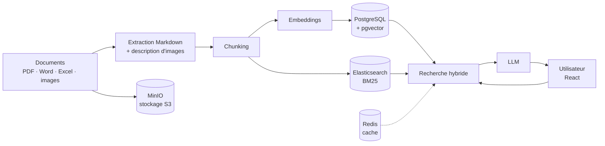

<!-- PROJECT SHIELDS -->

[![LinkedIn][linkedin-shield]][linkedin-url]
[![GitHub][github-shield]][github-url]

<!-- PROJECT HEADER -->
 

  <h1 align="center">RAG Platform – Public Overview</h1>

  

    Plateforme <strong>Retrieval-Augmented Generation (RAG)</strong> multimodale, full-stack et orientée production :
    ingestion de documents (PDF, Word, Excel, images), recherche hybride et génération de réponses par LLM.
     
     
    <a href="#démonstration"><strong>Voir la démo »</strong></a>
    &middot;
    <a href="#résultats">Résultats</a>
    &middot;
    <a href="#contact">Contact</a>
  

<!-- TABLE OF CONTENTS -->

  
Sommaire

  <ol>
    <li>
      <a href="#à-propos">À propos</a>
      <ul>
        <li><a href="#technologies">Technologies</a></li>
      </ul>
    </li>
    <li><a href="#fonctionnalités">Fonctionnalités</a></li>
    <li><a href="#architecture">Architecture</a></li>
    <li><a href="#démonstration">Démonstration</a></li>
    <li><a href="#résultats">Résultats</a></li>
    <li><a href="#accès-au-code">Accès au code</a></li>
    <li><a href="#contact">Contact</a></li>
  </ol>

<!-- ABOUT THE PROJECT -->
## À propos

Ce dépôt public présente la description, l'architecture et les résultats d'une plateforme **RAG** complète, conçue, développée et déployée en autonomie pour une entreprise d'architecture en Indonésie.

**Le besoin :** retrouver rapidement une information dans une base documentaire composée en majorité d'images, mais aussi de documents Word, PDF et de tableaux.

**La solution :** une plateforme qui ingère ces documents, les rend interrogeables en langage naturel et répond en citant ses sources (texte et images).

(<a href="#readme-top">retour en haut</a>)

### Technologies

[![Python][python-shield]][python-url]
[![FastAPI][fastapi-shield]][fastapi-url]
[![PostgreSQL][postgres-shield]][postgres-url]
[![Elasticsearch][elastic-shield]][elastic-url]
[![MinIO][minio-shield]][minio-url]
[![Redis][redis-shield]][redis-url]
[![React][react-shield]][react-url]
[![TypeScript][ts-shield]][ts-url]
[![Tailwind CSS][tailwind-shield]][tailwind-url]
[![Docker][docker-shield]][docker-url]

(<a href="#readme-top">retour en haut</a>)

<!-- FEATURES -->
## Fonctionnalités

- **Ingestion multi-formats** : PDF, Word, Excel et images
- **Extraction en Markdown** et **description automatique des images** par un modèle de vision
- **Chunking** intelligent des documents
- **Embeddings vectoriels** stockés dans PostgreSQL + pgvector
- **Recherche hybride** : mot-clé (BM25, Elasticsearch) + sémantique (pgvector)
- **Génération de réponses** par LLM, avec texte et images en sources
- **Interface web** pour interroger la base documentaire

(<a href="#readme-top">retour en haut</a>)

<!-- ARCHITECTURE -->
## Architecture

Le back-end est découpé en **10 microservices FastAPI** conteneurisés avec Docker et déployés sur un serveur Hetzner.

| Couche | Technologies |
|---|---|
| Back-end | FastAPI (10 microservices) |
| Base vectorielle et recherche | PostgreSQL + pgvector, Elasticsearch (BM25) |
| Stockage et cache | MinIO (compatible S3), Redis |
| Front-end | React, TypeScript, Tailwind CSS |
| Orchestration et déploiement | Docker, Docker Compose, Hetzner |

(<a href="#readme-top">retour en haut</a>)

<!-- DEMO -->
## Démonstration

### Présentation

https://github.com/user-attachments/assets/d11c8c0a-2380-40a0-95d7-6de04653331b

### Pipeline d'ingestion

<table>
<tr>
<td width="50%">

**Description d'image**

https://github.com/user-attachments/assets/4c4a090f-716c-461c-9e1b-2f820efc2fb0

</td>
<td width="50%">

**Extraction Markdown**

https://github.com/user-attachments/assets/cef341c4-188f-4d79-af28-841798fd7024

</td>
</tr>
<tr>
<td width="50%">

**Chunking**

https://github.com/user-attachments/assets/1ef7bad2-5bdb-4be6-a755-97a386865314

</td>
<td width="50%">

**Embedding**

https://github.com/user-attachments/assets/aabf896b-81ad-4559-9525-cbcb4225cee0

</td>
</tr>
</table>

### Recherche et réponses

<table>
<tr>
<td width="50%">

**Réponse par mot-clé**

https://github.com/user-attachments/assets/1667cab4-e63b-45ff-8eb6-347479ebf81f

</td>
<td width="50%">

**Réponse mot-clé + sémantique**

https://github.com/user-attachments/assets/8f929062-1d0e-4a32-a926-9ca813326004

</td>
</tr>
<tr>
<td width="50%">

**Mot-clé + sémantique + image (1)**

https://github.com/user-attachments/assets/69306bf9-fe78-42c8-aae8-238ecb61edf0

</td>
<td width="50%">

**Mot-clé + sémantique + image (2)**

https://github.com/user-attachments/assets/a4cbe0db-a47f-4421-a496-4d733eaaca95

</td>
</tr>
<tr>
<td width="50%">

**Réponse texte uniquement**

https://github.com/user-attachments/assets/ccdb2673-ea68-4d3b-87de-baeb8ac18c79

</td>
<td width="50%"></td>
</tr>
</table>

(<a href="#readme-top">retour en haut</a>)

<!-- RESULTS -->
## Résultats

Mesurés sur la base documentaire de l'entreprise (une centaine de documents) :

| Indicateur | Résultat |
|---|---|
| Réponses correctes | **91 %** sur 100 requêtes |
| Temps de réponse moyen | **3,21 s** |
| Temps de recherche documentaire | **−87 %** |

(<a href="#readme-top">retour en haut</a>)

<!-- CODE ACCESS -->
## Accès au code

Le code source complet (back-end, front-end, infrastructure) est hébergé dans un **dépôt privé**, car il s'agit d'un projet réalisé pour une entreprise.

Un accès peut être accordé **sur demande** dans le cadre d'un processus de recrutement : voir [Contact](#contact).

(<a href="#readme-top">retour en haut</a>)

<!-- CONTACT -->
## Contact

**Gabin Niel** – Ingénieur IA (RAG, agents IA, data)

- Email : gabin.niel.pro@gmail.com
- LinkedIn : [gabin-niel](https://www.linkedin.com/in/gabin-niel-749062233/)
- GitHub : [GABINNIELPRO](https://github.com/GABINNIELPRO)

(<a href="#readme-top">retour en haut</a>)

<!-- MARKDOWN LINKS & IMAGES -->
[linkedin-shield]: https://img.shields.io/badge/LinkedIn-0A66C2?style=for-the-badge&logo=linkedin&logoColor=white
[linkedin-url]: https://www.linkedin.com/in/gabin-niel-749062233/
[github-shield]: https://img.shields.io/badge/GitHub-181717?style=for-the-badge&logo=github&logoColor=white
[github-url]: https://github.com/GABINNIELPRO
[python-shield]: https://img.shields.io/badge/Python-3776AB?style=for-the-badge&logo=python&logoColor=white
[python-url]: https://www.python.org/
[fastapi-shield]: https://img.shields.io/badge/FastAPI-009688?style=for-the-badge&logo=fastapi&logoColor=white
[fastapi-url]: https://fastapi.tiangolo.com/
[postgres-shield]: https://img.shields.io/badge/PostgreSQL-4169E1?style=for-the-badge&logo=postgresql&logoColor=white
[postgres-url]: https://www.postgresql.org/
[elastic-shield]: https://img.shields.io/badge/Elasticsearch-005571?style=for-the-badge&logo=elasticsearch&logoColor=white
[elastic-url]: https://www.elastic.co/elasticsearch
[minio-shield]: https://img.shields.io/badge/MinIO-C72E49?style=for-the-badge&logo=minio&logoColor=white
[minio-url]: https://min.io/
[redis-shield]: https://img.shields.io/badge/Redis-DC382D?style=for-the-badge&logo=redis&logoColor=white
[redis-url]: https://redis.io/
[react-shield]: https://img.shields.io/badge/React-20232A?style=for-the-badge&logo=react&logoColor=61DAFB
[react-url]: https://react.dev/
[ts-shield]: https://img.shields.io/badge/TypeScript-3178C6?style=for-the-badge&logo=typescript&logoColor=white
[ts-url]: https://www.typescriptlang.org/
[tailwind-shield]: https://img.shields.io/badge/Tailwind_CSS-06B6D4?style=for-the-badge&logo=tailwindcss&logoColor=white
[tailwind-url]: https://tailwindcss.com/
[docker-shield]: https://img.shields.io/badge/Docker-2496ED?style=for-the-badge&logo=docker&logoColor=white
[docker-url]: https://www.docker.com/
